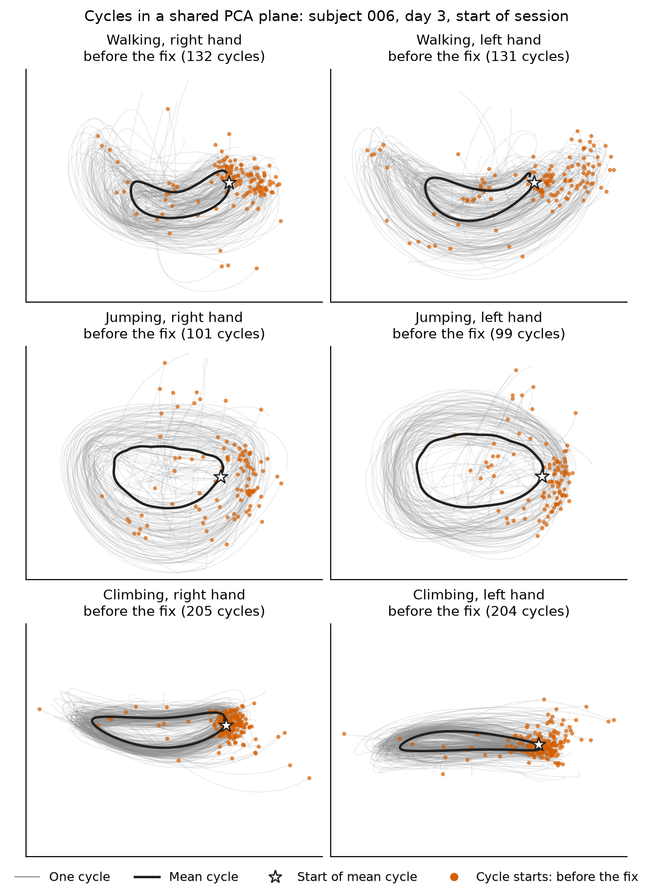
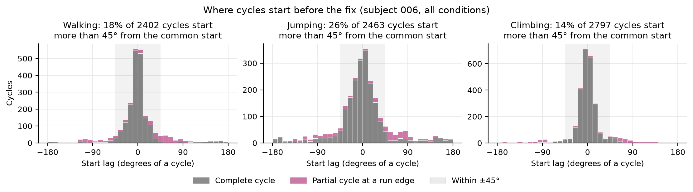
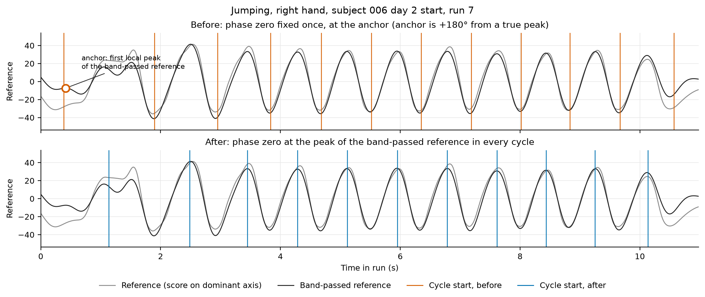
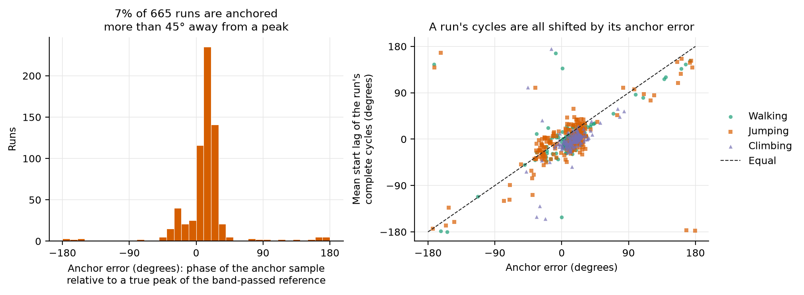
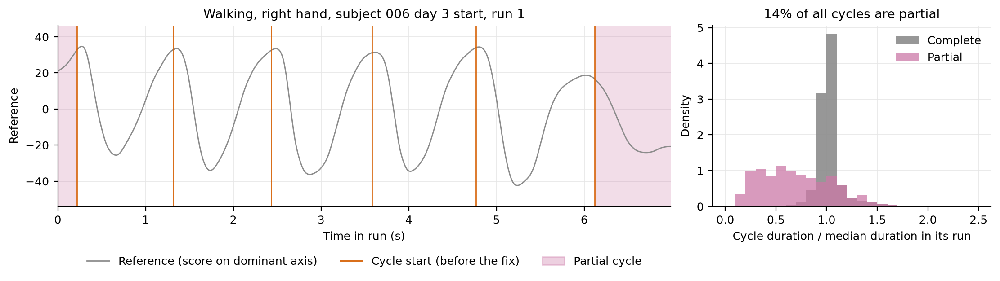
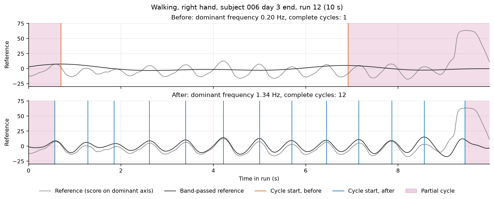
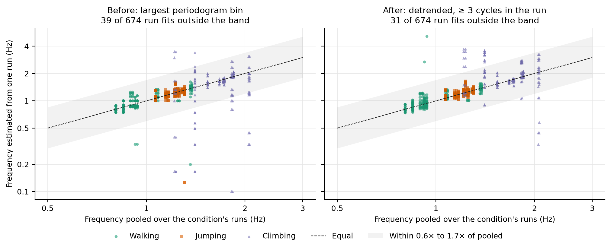
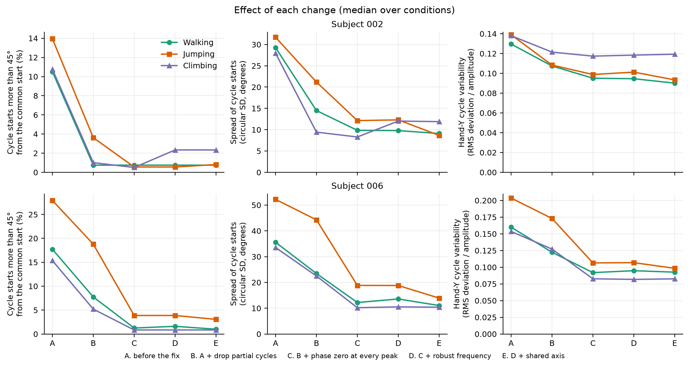
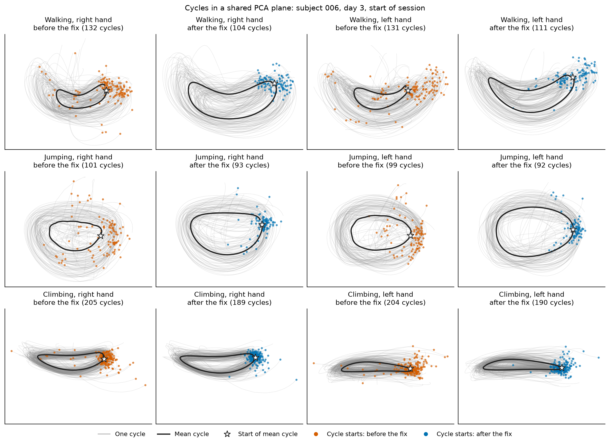
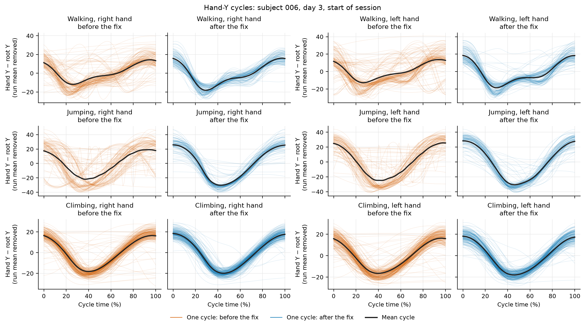

# Issue #3: inconsistent cycle-start alignment

Workup of [issue #3](https://github.com/Motor-Learning-Lab/phase-coordinates/issues/3), and the
fix that came out of it.

"Before the fix" means `main` at `d83b30d`, the commit named in the issue. "After the fix" means
the package on this branch. Every number and figure here is produced by
`issue_3_cycle_start_alignment.ipynb` in this folder.

## Summary

Noam's observation is correct, and most of it came from the package, not from her pipeline or from
the movement.

Before the fix, **19% of subject 006's cycles started more than an eighth of a cycle away from
where the other cycles of the same condition start** (13% for subject 002). After the fix that is
**2%** (1% for subject 002), and her cycle-variability measure for subject 006 falls by half (0.18
to 0.09). So about half of the variability she would have measured was segmentation error.

There were three causes, in order of size:

1. **Phase zero was set once per run, from one unreliable sample.** If that sample was off, every
   cycle in the run was shifted by the same amount. About 7% of runs were shifted by more than an
   eighth of a cycle, some by half a cycle.
2. **The leftover pieces at the two ends of each run were returned as ordinary cycles.** They are
   14% of all cycles for subject 006, and 72% of them are misaligned.
3. **The dominant frequency was estimated separately for each run, with a rule that slow drift
   could capture.** In 24 of 794 fits the run was cut into fewer than two complete cycles.

All three are fixed in the package on this branch ([What changed](#what-changed-in-the-package)).
What Noam needs to change in her own code is in [How to use it](#how-to-use-it).

## What was done

- **Data.** Subject 006, all three days and session parts (the files attached to the issue), and
  subject 002, day 1 start and day 3 end (the files already in `test_data/`). That is 397 movement
  runs and 794 run × hand fits. Runs were built with the rules in `labeled_analysis.py`.
- **Reproduction.** `fit_pca_phase_coordinates(xyz, sampling_rate_hz=60)` per run and hand, with
  boundaries from `sample_start` / `sample_stop`, as in the issue.
- **A switchable copy of the segmentation.** `_issue3.py` holds a stand-alone segmentation in which
  each change is a separate switch. With every switch off it reproduced the package at `d83b30d`
  cycle for cycle in all 794 fits. With every switch on it equals the package on this branch in all
  794 fits, with and without a shared axis. The steps in between are what the tables below show.
- **The figure from the issue.** The common-plane QC figure and the subject 002 files were
  described in the issue but not attached. Figure 1 rebuilds the figure from
  `plot_common_plane_cycle_qc()` for the same condition (subject 006, day 3, start).



*Figure 1. Cycles before the fix in a shared PCA plane, built as in the issue. Most starts cluster;
some are scattered around the loop.*

## How misalignment is measured

The measure must not depend on the phase the package computed. Each time-normalised 3-D cycle is
treated as a closed loop and slid along itself until it best matches the mean loop of its condition
(subject × skill × day × part × hand). The slide needed is the cycle's **start lag**, in degrees of
a cycle. A cycle is called **misaligned** when its start lag exceeds 45°, an eighth of a cycle.
Only the shapes of the cycles are compared.



*Figure 2. Start lags before the fix, subject 006. Partial cycles (pink) are spread over the whole
circle. Complete cycles (grey) have a main peak and a second group near ±180°.*

## Cause 1: one sample set phase zero for the whole run

For the automatic reference, `fit_pca_phase_coordinates` found the first local peak of the
band-passed reference and subtracted the phase at that sample from the whole run. Every later
boundary was a multiple of 2π counted from that sample.

That sample is the least reliable one in the run. It lies within about one cycle of the start of
the record, where the band-pass filter and the Hilbert transform are still settling, and
`find_peaks` accepts any local maximum, however small.



*Figure 3. One jumping run. Top: the anchor lands on a small bump in a trough, so every boundary
falls in a trough. Bottom: boundaries at the peak of the band-passed reference in every cycle.*

The Hilbert phase at the anchor sample should be 0. Its actual value is the run's **anchor error**.

| | Subject 006 | Subject 002 |
|---|---|---|
| Runs with anchor error above 45° | 6.8% | 6.0% |
| Spread of start lags between runs (complete cycles) | 32° | 25° |
| Spread of start lags within a run | 14° | 9° |
| Spread between runs after subtracting each run's anchor error | 19° | 8° |

Cycles within a run agree with each other. Runs disagree with one another, and the anchor error
predicts by how much.



*Figure 4. Left: anchor error over subject 006's runs. Right: the mean start lag of each run's
complete cycles against its anchor error.*

This also explains why Noam's first attempt, with hand Y as an explicit `ref_signal`, was
inconsistent. For an explicit reference, phase zero was the phase of the run's first sample, which
is wherever the run happened to begin.

## Cause 2: partial cycles at the ends of each run

A run starts and stops where the movement classifier switched on and off. The pieces before the
first boundary and after the last one were kept as cycles whenever they had at least 10 samples,
with nothing to tell them apart from complete cycles.

| | Subject 006 | Subject 002 |
|---|---|---|
| Partial cycles, share of all cycles | 14.4% | 10.8% |
| Misaligned, among partial cycles | 72% | 76% |
| Misaligned, among complete cycles | 10% | 6% |

For subject 006, partial cycles are 54% of all misaligned cycles. They also explain the "unusual
trajectories" in the issue: a partial cycle is a fraction of a loop stretched to 100 points.



*Figure 5. Left: one walking run with its two partial cycles shaded. Right: partial cycles are
mostly much shorter than the complete cycles of their run.*

## Cause 3: the per-run dominant frequency

The band-pass was centred on the largest periodogram bin of that run's reference, at any positive
frequency. Runs are 3 to 31 s long. In a short run a slow drift can hold more power than the
movement, and the band followed the drift.



*Figure 6. A 10 s walking run. The old rule picks 0.20 Hz and returns one complete cycle. The new
rule, which detrends and requires at least three cycles in the run, picks 1.35 Hz and returns
twelve.*

With the old rule, 24 of 794 fits gave fewer than two complete cycles. With the new rule none do,
and 335 more complete cycles are recovered (8296 to 8631). It has little effect on the alignment of
the cycles that were already found.



*Figure 7. Per-run frequency against a frequency pooled over the run's condition, subject 006.
The low outliers on the left are drift. The disagreements that remain are almost all climbing; see
[Open questions](#open-questions).*

## Two smaller effects

- **Cycles that were not one block of samples.** A cycle is every sample whose phase lies in
  [2πk, 2π(k+1)). When the phase briefly ran backwards across a boundary, samples were assigned
  back to the previous cycle, and `sample_start`..`sample_stop` overlapped the neighbouring cycle.
  This affected 105 of 7662 cycles for subject 006 and 9 of 1912 for subject 002.
- **The reference axis differs between runs.** Each run gets its own dominant axis. The median
  angle to the condition's pooled axis is 6° to 13°, but 44 of 674 fits for subject 006 are more
  than 30° away, and in 2 the Y-based sign rule flips the axis.

## The fix, one change at a time

| | Change |
|---|---|
| A | The package before the fix. |
| B | A, keeping only complete cycles. |
| C | B, with phase zero at the peak of the band-passed reference in every cycle, and every cycle one block of samples. |
| D | C, with the more robust per-run frequency. This is the package on this branch, called as before. |
| E | D, with the reference axis estimated once per condition and shared by its runs. This is the package on this branch with `ref_axis=`. |

Subject 006 (674 fits):

| | Cycles | Misaligned | Start-lag spread | Hand-Y variability |
|---|---|---|---|---|
| A | 7662 | 19.2% | 40° | 0.182 |
| B | 6555 | 10.1% | 30° | 0.138 |
| C | 6587 | 3.4% | 16° | 0.103 |
| D | 6883 | 3.4% | 16° | 0.103 |
| E | 6895 | 2.3% | 13° | 0.094 |

Subject 002 (120 fits):

| | Cycles | Misaligned | Start-lag spread | Hand-Y variability |
|---|---|---|---|---|
| A | 1912 | 13.3% | 30° | 0.134 |
| B | 1706 | 5.9% | 16° | 0.107 |
| C | 1709 | 0.7% | 11° | 0.098 |
| D | 1748 | 1.1% | 10° | 0.100 |
| E | 1749 | 1.1% | 9° | 0.093 |

"Misaligned" is over all cycles pooled. "Start-lag spread" (circular SD) and "hand-Y variability"
are medians over conditions. Hand-Y variability is the measure from Noam's section 8: RMS deviation
of each time-normalised hand-Y cycle from the condition mean, divided by cycle amplitude.

D does not lower the misaligned share; its gain is the 335 cycles in runs that previously gave
almost none. Some of those recovered cycles are themselves irregular, which is why subject 002's
share rises slightly from C to D.



*Figure 8. The same three measures by skill. B and C carry almost all of the improvement.*



*Figure 9. Figure 1 again, with the result after the fix (E) beside it. The mean cycle changes too:
averaging misaligned cycles shrinks and distorts it.*



*Figure 10. The same cycles as hand Y against cycle time.*

**Sharing the frequency across runs was tried and left out.** It changes nothing where the movement
is stable and makes subject 006's day-1 climbing worse (12.7% misaligned against 3.9% with a
per-run frequency).

## What changed in the package

1. **Phase zero is the Hilbert phase as it is.** The single-sample anchor is gone. Every cycle
   starts at a peak of the band-passed reference. This now also holds for an explicit
   `ref_signal`. A phase supplied with `phase=` keeps its first sample as phase zero.
2. **Every cycle is one block of samples.** Cycle numbers follow the running maximum of the phase.
3. **`cycles` has four new columns.**
   - `complete`: the cycle has a boundary inside the record at both ends;
   - `duration_ratio`: duration over the median duration of the complete cycles;
   - `amplitude_ratio`: mean Hilbert amplitude over the median for the complete cycles;
   - `backward_steps`: samples where the phase ran backwards.
4. **`estimate_dominant_period` is robust to drift.** It detrends, tapers, zero-pads, and takes the
   strongest spectral peak among frequencies with at least three cycles in the record.
5. **A reference axis can be shared.** `dominant_reference_axis(runs)` estimates one axis from
   several runs, and `fit_pca_phase_coordinates(..., ref_axis=axis)` uses it. `details` now also
   returns `ref_axis` and the band actually used, `f_range`.

Behaviour that existing code may notice:

- Partial cycles are still returned, now marked `complete == False`. Code that used every row of
  `cycles` must filter on `complete`.
- On the automatic path, cycle numbers and `samples["phase"]` differ from before, and
  `details["phase_zero"]` no longer has `sample_index`.
- With an explicit `ref_signal`, cycle boundaries move from the first-sample convention to peaks.
- `samples["phase_in_cycle"]` follows the running maximum of the phase, so it no longer dips where
  the raw phase steps back. `samples["phase"]` is unchanged.
- `estimate_dominant_period` raises for records shorter than three cycles of any candidate
  frequency. The Bayesian estimator uses it for its seeds, so its band can change on records with
  drift.

Tests: `test_automatic_reference_is_y_oriented_and_peak_anchored` was rewritten for the new
behaviour, and 13 tests were added, covering a record that starts mid-cycle, a small bump before
the first peak, drift larger than the movement, a phase that steps back across a boundary, a
decreasing supplied phase, and the shared axis. The suite passes (77 passed, 1 skipped). The
skipped test is the Bayesian smoke test, which needs PyMC; its body was run by hand in the `bayes`
environment and passes.

## How to use it

For Noam's pipeline, two changes in `labeled_analysis.py`:

```python
from phase_coordinates import dominant_reference_axis, fit_pca_phase_coordinates

# once per subject x skill x day x part x hand
axis = dominant_reference_axis([run_xyz(row, hand) for row in condition_runs.itertuples()])

# per run
samples, cycles, details = fit_pca_phase_coordinates(xyz, ref_axis=axis, sampling_rate_hz=FS_HZ)
cycles = cycles[cycles["complete"]]
```

Without `ref_axis` the call is the same as before and gives variant D.

`fit_with_absolute_phase_zero` in `_issue3.py` was a workaround for the package before the fix. It
is not needed on this branch.

## Answers to the six questions in the issue

1. **Does the automatic reference aim for consistent starts across runs?** It aimed to and failed
   in the two ways above: the single anchor, and partial cycles. Both are fixed.
2. **Is the dominant-PC reference suitable for elongated, back-and-forth trajectories?** Yes. The
   first component holds on average 70% (jumping) to 84% (climbing) of the variance in these data,
   and with the anchor fixed the starts are tight for all three skills. Flatter loops are the easy
   case; it is the rounder jumping loops where the axis direction is less stable between runs.
3. **Can independently estimated references or bands move phase zero between runs?** Yes. The
   anchor was the large effect. Run-to-run differences in the axis are the next, and `ref_axis`
   removes them. The band matters mainly when it is badly wrong.
4. **Do partial or irregular cycles stay in `cycles`? Is there a criterion?** They stay, and are
   now marked. Drop cycles with `complete == False`. For the rest, flag a cycle when
   `duration_ratio` is outside 0.6 to 1.5, `amplitude_ratio` is below 0.5, or `backward_steps` is
   above 0. With the shared axis this flags 5.7% of subject 006's cycles: 32% of the flagged cycles
   are misaligned against 0.5% of the unflagged, and 81% of the misaligned cycles are caught.
   Subject 002 has too few misaligned cycles left for this to be informative.
5. **Which outputs to examine?** The four new columns of `cycles`, plus `details["f_range"]`
   against what you expect for the movement, and the number of complete cycles against the run
   length.
6. **Recommended approach?** Keep the automatic reference, share the axis across the runs of a
   condition with `ref_axis`, keep the frequency per run, and use only complete cycles.

## Open questions

- **Day-1 climbing for subject 006.** Per-run frequencies there are 2.4 to 3.7 Hz, while the pooled
  spectrum peaks near 1.2 to 1.4 Hz, about half. Later days are stable near 1.7 Hz. I could not
  establish which of the two is the movement cycle on day 1. The per-run cycles are the more
  self-consistent, but that does not settle it. Noam is better placed to say what the hands are
  doing in those runs.
- **Two subjects.** Subject 002 has only two of nine conditions. The causes are mechanical, so I
  expect them to hold for the other subjects, but the sizes may differ.
- **Phase zero is the peak of the band-passed reference, not of the raw signal.** For a waveform
  that is not symmetric these differ by a constant. That does not affect consistency, and I did not
  measure the offset.
- **The 45° threshold is a choice.** The start-lag spread does not depend on it and tells the same
  story.
- **The Bayesian estimator was only smoke-tested.** It runs and returns the new columns. Whether
  the new frequency rule changes its results on real data was not examined.
- **The earlier Gorilla Tag notebooks were not re-run.** `notebooks/gorilla_tag_analysis/` used an
  explicit `ref_signal` and cached fits from the old behaviour; re-running them will move their
  cycle boundaries to peaks.

## Files

| File | Contents |
|---|---|
| `REPORT.md` | This report. |
| `issue_3_cycle_start_alignment.ipynb` | Executed notebook; every number and figure above. |
| `_issue3.py` | Loading, the switchable segmentation, the measures. |
| `_issue3_plots.py` | Figure code. |
| `data/hand_root_xyz.npz` | Root and hand positions for the 35 source files, stored as float32. |
| `figures/` | The eleven figures the notebook writes. |
